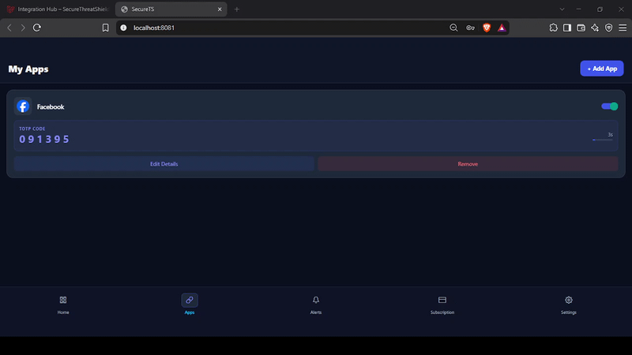
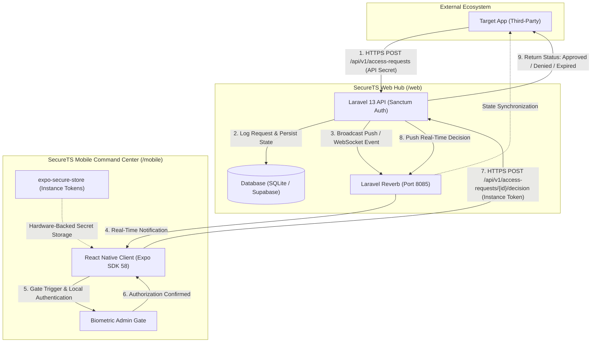

# SecureThreatShield (SecureTS)


A high-speed, monorepo-based security command center and active session management platform protecting Target Apps with MFA, biometric gates, and emergency lockdown.

[](.github/workflows/tests.yml)
[](https://vercel.com)
[](https://expo.dev)
[](https://laravel.com)
[](https://reactnative.dev)

---

## Core Features

### Web Platform (The Hub)



- **Integration Hub:** Register third-party Target Apps with dedicated Integration IDs and securely hashed API Secrets, supporting instant credential revocation and rotation.
- **Security Audit Trail:** Complete, immutable logging of all access requests, verification results (`approved`, `denied`, `expired`), IP addresses, and device fingerprints.
- **Active Session Management:** Centralized visibility over active user sessions across all connected Target Apps with immediate remote termination.
- **Stripe Subscriptions:** Tiered developer and organization billing (Pro, Ultra, Ultra Plus) managing integration caps, device limits, and team quotas.

### Mobile App (The Command Center)


- **Push Login Approvals:** Instant, interactive approve/deny prompts dispatched via high-throughput Laravel Reverb WebSockets and Expo Push Notifications (target p95 latency < 2s).
- **Emergency "Swipe-to-Lockdown" Kill Switch:** Rapid one-action gesture that immediately invalidates all active sessions, revokes access tokens, and freezes connected Target App authorizations.
- **Biometric Admin Gates:** Local FaceID / TouchID / biometric authentication guarding high-security operations, token rotations, and sensitive approval confirmations.
- **TOTP Fallback:** Built-in RFC 6238 time-based one-time password generator (30-second rotating codes with visual countdown indicator) guaranteeing uninterrupted offline authentication.

---

## Architecture & Monorepo Map

### Monorepo Structure

```
securets/
├── web/                             # Web Dashboard, REST API & WebSocket Server
│   ├── app/                         # Controllers, Models, Events, Notifications
│   │   ├── Http/
│   │   │   ├── Controllers/
│   │   │   └── Requests/
│   │   ├── Models/
│   │   └── Events/
│   ├── bootstrap/                   # App initialization & provider bindings
│   ├── config/                      # Laravel environment configuration
│   ├── database/                    # Migrations, seeders, and factories
│   │   ├── factories/
│   │   ├── migrations/
│   │   └── seeders/
│   ├── public/                      # Static assets & entry index.php
│   ├── resources/                   # Livewire 4 components, Blade, Tailwind CSS
│   │   ├── css/
│   │   ├── js/
│   │   └── views/
│   ├── routes/                      # API, Web, Console, and Channels routes
│   │   ├── api.php
│   │   ├── channels.php
│   │   ├── console.php
│   │   └── web.php
│   ├── tests/                       # Pest 5 feature and unit test suite
│   │   ├── Feature/
│   │   └── Unit/
│   ├── composer.json                # PHP dependencies & dev scripts
│   ├── package.json                 # Web frontend dependencies & Vite scripts
│   ├── phpstan.neon                 # Larastan static analysis configuration
│   └── vite.config.js               # Vite asset bundling pipeline
│
└── mobile/                          # Command Center Authenticator App
    ├── components/                  # UI components, icons & biometric modals
    ├── public/                      # Mobile application branding & icons
    ├── scripts/                     # Network utilities (LAN / Tailscale detector)
    │   └── detect-lan-ip.js
    ├── src/
    │   ├── api/                     # Sanctum HTTP client (axios wrapper)
    │   │   └── client.js
    │   ├── lib/                     # Secure store & crypto utilities
    │   └── theme/                   # WorkOS-inspired dark mode theme tokens
    ├── App.jsx                      # Main application root & screen routing
    ├── app.json                     # Expo SDK 58 project configuration
    └── package.json                 # React Native & Expo dependencies
```

### Communication & Security Flow



---

## Tech Stack Ecosystem

| Layer | Technologies | Role & Purpose |
| :--- | :--- | :--- |
| **Web API & Hub** | **Laravel 13** & **PHP 8.3+** | High-performance core backend framework and REST API engine. |
| **Server-Driven UI** | **Livewire 4** & **Blaze** | Real-time reactive web dashboard and integration management interface. |
| **Styling & Design** | **Tailwind CSS** (Vite) | WorkOS-inspired minimalist dark mode UI implementation. |
| **Real-Time Engine** | **Laravel Reverb** (Port 8085) | Ultra-low latency WebSocket broadcasting server for instant mobile approvals. |
| **Mobile Core** | **React Native** & **Expo** (SDK 58) | Cross-platform Command Center authenticator client. |
| **Mobile Security** | **`expo-secure-store`** | Encrypted hardware-backed storage for device Instance Tokens and secrets. |
| **Database (Dev)** | **SQLite** | Zero-configuration local database for frictionless development and CI tests. |
| **Database (Prod)** | **Supabase (PostgreSQL)** | Distributed cloud PostgreSQL for production persistence and team environments. |

---

## Quick Start (Zero to Hero)

> [!IMPORTANT]
> Physical mobile devices and the host development workstation must reside on the same Local Area Network (LAN) or be interconnected via a **Tailscale** mesh network.

### 1. Web Platform Setup

Navigate into the `/web` directory to configure and start the backend ecosystem:

```bash
cd web

# 1. Automated initialization (installs dependencies, copies .env, generates keys, runs migrations)
composer run setup

# 2. Start all services concurrently (Laravel API on 0.0.0.0:8000, Reverb on 8085, queue worker, Vite)
composer run dev
```

The web dashboard is now accessible at `http://localhost:8000`.

### 2. Mobile App Setup

In a separate terminal session, configure and launch the mobile Command Center:

```bash
cd mobile

# 1. Install dependencies and prepare environment configuration
npm install
cp .env.example .env

# 2. Launch the development server
# Recommended for cross-network access (Tailscale):
npm run start:tailscale

# Standard Local Area Network (LAN) mode:
npm start

# Target-specific emulator / simulator runs:
npm run android
npm run ios
```

Scan the terminal QR code using **Expo Go** on your physical mobile device.

---

## Rigorous CI/CD Standards

SecureTS enforces a strict continuous integration gate on all pull requests and branch merges into `main` using GitHub Actions:

- **Formatting Validation:** Code style consistency enforced strictly via `Laravel Pint` (`pint --parallel --test`).
- **Static Type Analysis:** Highest-tier strict static analysis with `Larastan` / `PHPStan` at **Level 9**.
- **Automated Test Suite:** Comprehensive feature and unit verification powered by `Pest 5` executed against an isolated in-memory SQLite database (`:memory:`).

To execute the identical verification suite locally prior to opening a PR:

```bash
cd web
composer run test
```

---

## Deployment Targets

- **Web API & Dashboard:** Optimized for serverless edge execution on **Vercel** utilizing the `vercel-php` runtime with optimized asset caching and environment-level database pooling.
- **Mobile Authenticator:** Production builds compiled and distributed across iOS (App Store / TestFlight) and Android (Google Play / APK) via **Expo Application Services (EAS)**.

---

## Documentation & License

### Documentation

- [Product Requirements Document (PRD)](PRD.md)
- [Contributing Guidelines](CONTRIBUTING.md)
- [Security Policy](SECURITY.md)
- [Code of Conduct](CODE_OF_CONDUCT.md)
- [AI Agent Operating Guide](AGENTS.md)

### License

Distributed under the [MIT License](LICENSE).  
Copyright &copy; 2026 Secure ThreatShield Organization. All rights reserved.
